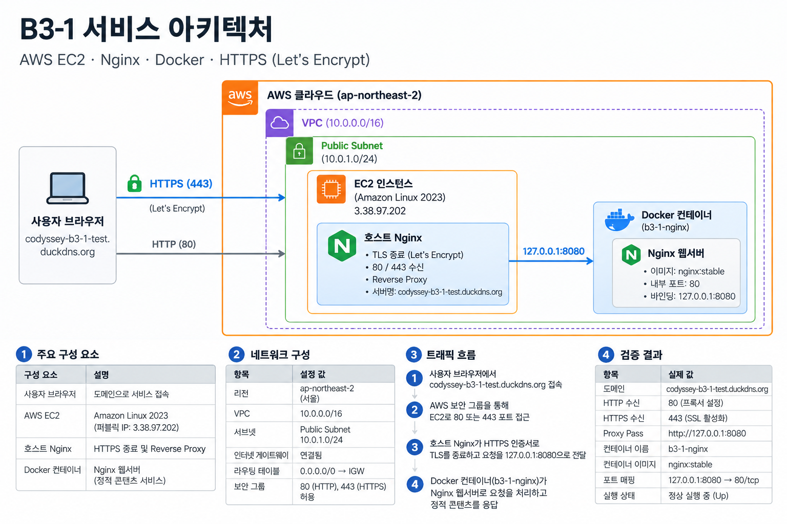

# B3-1 | AWS 웹 서비스 인프라 구축 및 배포

코디세이 B3-1 **「내가 만든 웹사이트를 인터넷에 올려 누구나 쓰게 하기」** 미션의 실습 기록이다. AWS 서울 리전에 퍼블릭 웹 서비스 환경을 구축하고, 네트워크·접근 제어·웹 서버·Docker·HTTPS의 동작을 검증했다.

> **실습 환경 안내:** 아래 주소와 퍼블릭 IP는 실습 당시의 값이다. EC2 또는 DNS 설정 변경, 리소스 정리 이후에는 접속되지 않을 수 있다. 본 저장소는 배포 자동화 코드가 아닌 **구축 및 검증 증빙 중심의 기록**이다.

## 1. 서비스 접속 및 외부 검증

- **미션 필수 검증 방식:** **(A) 브라우저에서 `http://<퍼블릭IP>` 접속**
- 실습 당시 퍼블릭 IP: `3.38.97.202`
- 검증 URL: `http://3.38.97.202/`
- 도메인(보너스): `codyssey-b3-1-test.duckdns.org`
- HTTPS URL(보너스): `https://codyssey-b3-1-test.duckdns.org/`
- **실습 결과:** 브라우저에서 웹 페이지 표시 및 HTTP 200 응답 확인. HTTPS 접속 및 인증서 검증도 수행함.

외부 접속 증빙: [L3 외부 HTTP 화면](evidence/03-ec2-nginx/L3-external-http.png), [L7 외부 HTTP 검증](evidence/07-final-verification/L7-external-http.png), [L7 외부 HTTPS 검증](evidence/07-final-verification/L7-external-https.png).

## 2. 아키텍처



설계 상세: [아키텍처 문서](docs/architecture.md)

요청 흐름: **브라우저 → DNS/인터넷 → AWS VPC의 Public Subnet에 있는 EC2 → 호스트 Nginx(80/443, HTTPS TLS 종료) → `127.0.0.1:8080` → Docker Nginx(컨테이너 80)**

| 구성 요소 | 실습 구성 |
|---|---|
| AWS 리전 | `ap-northeast-2` (서울) |
| 네트워크 | VPC `10.0.0.0/16`, Public Subnet `10.0.1.0/24` |
| 인터넷 연결 | Internet Gateway, 기본 라우트 `0.0.0.0/0 → IGW` |
| 서버 | EC2 `t3.micro`, Amazon Linux 2023 |
| 스토리지 | EBS gp3, 8 GiB |
| Security Group | HTTP 80·HTTPS 443 외부 허용, SSH 22 개인 IP `/32` 제한 |
| 서비스 | 호스트 Nginx 리버스 프록시 + Docker의 Nginx |
| HTTPS | DuckDNS 서브도메인 + Let's Encrypt 인증서 |

현재 확인된 Nginx 설정에서는 HTTP(80)와 HTTPS(443)가 모두 내부 서비스로 프록시된다. **HTTP에서 HTTPS로 자동 리다이렉트된다고 가정하지 않는다.**

## 3. Docker 배포 (보너스)

- **컨테이너 이름:** `b3-1-nginx`
- **이미지:** `nginx:stable`
- **실행 방식:** EC2에서 Docker 컨테이너를 실행하고, 호스트 Nginx를 리버스 프록시로 구성
- **포트 매핑:** 호스트 `127.0.0.1:8080` → 컨테이너 `80/tcp`
- **상태 검증:** `docker ps`에서 컨테이너 `Up` 확인, 호스트 HTTP 요청 및 외부 접속 확인

실제 실행 상태를 확인한 명령:

```bash
sudo docker ps --format 'table {{.Names}}\t{{.Image}}\t{{.Ports}}\t{{.Status}}'
sudo nginx -T 2>&1 | grep -E 'server_name|listen |proxy_pass'
```

검증 화면 2장 이상:

- [Docker 컨테이너 Up 상태](evidence/04-docker/L4-docker-ps.png)
- [Docker 서비스 외부 HTTP 접속](evidence/04-docker/L4-external-http.png)
- [최종 Docker 포트 매핑 확인](evidence/07-final-verification/L7-docker-ps.png)

> 이 저장소에는 Docker 실행을 위한 독립적인 배포 스크립트나 Docker Compose 파일이 아직 포함되어 있지 않다. 위 항목은 실제 구축·확인한 실행 구성을 설명한다.

## 4. 접근 제어 및 운영 검증

- IAM 사용자 `b3-1-operator`를 사용하여 실습을 진행했다. 콘솔에서 연결된 정책 3개(`B3-1-EC2-VPC-Policy`, `IAMUserChangePassword`, `SignInLocalDevelopmentAccess`)와 `AdministratorAccess` 미연결을 확인했다. 실습용 정책의 두 Statement는 EC2/VPC 관련 작업별 권한과 서울 리전 조건을 설정하여 **미션 수준의 최소권한 취지에 부합**한다. 이는 계정의 모든 유효 권한을 감사했다는 뜻은 아니다.
- SSH는 개인 IP로 소스를 제한하고, HTTP/HTTPS 포트만 외부에 공개했다.
- 외부/내부 HTTP 통신, 네트워크 경로, TLS 인증서, Nginx, Docker 실행 상태를 단계별로 확인했다.
- 502 Bad Gateway 장애를 재현한 후 Nginx 오류 로그를 근거로 원인을 분석하고 설정을 복구했다.

최종 확인: [L7 검증 기록](evidence/07-final-verification/L7-final-verification.md) · [문제 재현 로그](evidence/06-troubleshooting/L6-nginx-error-log.png)

## 5. 제출 산출물 및 진행 상태

| 미션 산출물 | 경로 | 상태 |
|---|---|---|
| 아키텍처 다이어그램 (PNG) | [`docs/architecture.png`](docs/architecture.png) | 작성 완료 |
| 외부 접속 검증 (방식 A) | [`evidence/03-ec2-nginx/L3-external-http.png`](evidence/03-ec2-nginx/L3-external-http.png) | 검증 완료 |
| 트러블슈팅 보고서 | [`docs/troubleshooting.md`](docs/troubleshooting.md) | 작성 완료 |
| 리소스 정리 체크리스트 | [`docs/cleanup-checklist.md`](docs/cleanup-checklist.md) | 문서 작성 완료 / 리소스 삭제 미완료 |

**주의:** 이 README 작성 시점에는 AWS 실습 리소스 삭제를 완료했다고 확인하지 않았다. 실습 종료 시 과금 위험을 줄이기 위해 EC2, EBS, Elastic IP(할당한 경우), IGW, VPC 및 관련 리소스를 점검·정리하고 삭제 증거를 남겨야 한다.

## 6. 저장소 구성

```text
B3-1/
├── README.md
├── docs/
│   ├── architecture.md
│   ├── architecture.png
│   ├── mission-verification.md  # 요구사항별 검증
│   ├── troubleshooting.md       # 작성 완료
│   └── cleanup-checklist.md     # 작성 완료, 정리 실행 전
├── evidence/
│   ├── 01-account-iam/          # L0~L1 비용·계정·IAM
│   ├── 02-network/              # L2 VPC·Subnet·IGW·라우팅
│   ├── 03-ec2-nginx/            # L3 EC2·Nginx·SSH·HTTP
│   ├── 04-docker/               # L4 컨테이너 및 외부 통신
│   ├── 05-domain-https/         # L5 DNS·TLS·인증서 갱신
│   ├── 06-troubleshooting/      # L6 502 장애 재현·복구
│   └── 07-final-verification/   # L7 통합 검증
├── scripts/                     # 현재 배포 스크립트 없음
└── .gitignore
```

## 7. 보안 및 증빙 관리

저장소는 **Private**로 유지한다. 공유용 스크린샷에서는 확인된 인증 토큰, 계정 이메일 등 민감한 정보를 마스킹했다. SSH 개인 키, AWS 자격 증명, 비밀번호 파일, 마스킹 전 이미지(`evidence/no_mask/`)는 Git 추적 대상에서 제외한다.

비공개 저장소라도 증빙 이미지와 문서 전체를 배포·공개 전에 재검토해야 한다. 과거에 노출된 DuckDNS 토큰은 재생성했고, 이후 도메인 DNS 응답 정상 여부를 확인했다.
