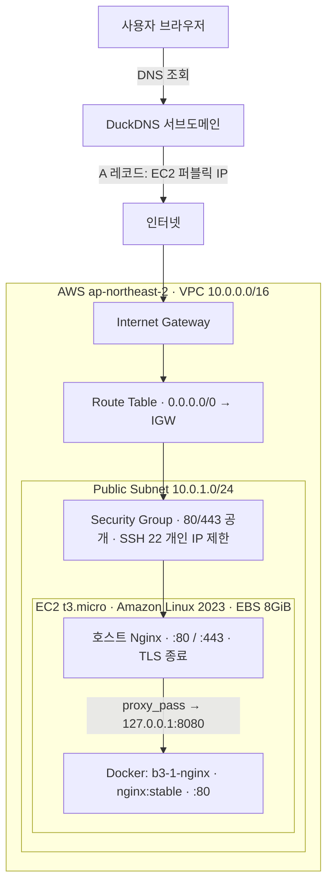

# B3-1 인프라 아키텍처

## 1. 목적과 범위

서울 리전의 단일 퍼블릭 EC2에서 HTTP/HTTPS 웹 서비스를 제공한다. EC2 호스트의 Nginx를 외부 진입점과 TLS 종료 지점으로 사용하고, Docker 컨테이너에서 웹 콘텐츠를 제공한다.

이 문서는 2026-10-29까지 수행한 실습 및 검증 결과를 정리한 것이다. 구성 리소스 ID와 퍼블릭 IP는 운영 중 변경될 수 있다.

## 2. 구성도



> 도식은 요청 경로를 이해하기 위한 논리적 표현이다. Route Table은 패킷을 애플리케이션으로 직접 넘기는 중간 프록시가 아니며, SG는 인스턴스 트래픽에 적용되는 허용 규칙이다.

## 3. 주요 구성 요소

| 구성 요소 | 확인된 구성 | 역할 |
|---|---|---|
| 리전 | `ap-northeast-2` | AWS 리소스의 배치 위치 |
| VPC | `10.0.0.0/16` | 논리적 네트워크 격리 |
| Public Subnet | `10.0.1.0/24` | EC2 배치 |
| Internet Gateway / Route Table | 기본 경로 `0.0.0.0/0` → IGW | 인터넷 통신 경로 |
| Security Group | TCP 22: 개인 IP `/32`; 80/443: 외부 공개 | 인스턴스 접근 제어 |
| EC2 | `t3.micro`, Amazon Linux 2023 | 호스트 OS 및 웹 서버 실행 |
| EBS | gp3, 8 GiB | EC2 블록 스토리지 |
| DNS | `codyssey-b3-1-test.duckdns.org` | 도메인을 퍼블릭 IP로 해석 |
| 호스트 Nginx | `listen 80`, `listen 443 ssl` | 외부 HTTP/HTTPS 수신, TLS 종료 및 프록시 |
| Docker | `b3-1-nginx`, 이미지 `nginx:stable` | 컨테이너 내부 80번 포트에서 웹 서비스 제공 |
| Docker 포트 게시 | `127.0.0.1:8080->80/tcp` | 호스트 내부에서만 컨테이너 접근 허용 |
| 인증서 | Let's Encrypt | 도메인의 HTTPS/TLS 인증 |

## 4. 요청 처리 흐름

1. 브라우저가 도메인의 DNS A 레코드를 조회하여 EC2 퍼블릭 IPv4를 얻는다.
2. 인터넷 트래픽이 IGW 및 VPC 네트워크 경로를 거쳐 EC2에 도달한다. Security Group이 80/443 연결을 허용한다.
3. 호스트 Nginx가 HTTP `:80` 또는 HTTPS `:443` 요청을 수신한다. HTTPS 연결의 TLS는 호스트 Nginx에서 종료된다.
4. Nginx가 `proxy_pass http://127.0.0.1:8080`으로 요청을 전달한다.
5. Docker의 호스트 루프백 포트 8080이 `b3-1-nginx` 컨테이너의 80번 포트로 매핑되어 웹 콘텐츠를 반환한다.

**중요:** 현재 확인된 Nginx 설정은 80과 443 모두 프록시한다. HTTP → HTTPS 자동 리다이렉트는 확인되지 않았으므로 구현된 기능으로 기록하지 않는다.

## 5. 설계 이유와 보안 경계

- 호스트 Nginx에서 TLS 인증서를 관리하면 컨테이너와 외부 TLS 진입점을 분리할 수 있다.
- Docker 포트를 `127.0.0.1`에만 바인딩하여 8080 포트를 인터넷에 직접 공개하지 않는다.
- SSH 22번 포트는 학습자 개인 IP로 제한하며, HTTP/HTTPS만 외부에 공개한다.
- AWS IAM은 클라우드 API 작업의 권한을 관리하고, Security Group은 인스턴스 네트워크 접근을 관리한다. 서로 대체하는 제어 수단이 아니다.
- EC2 퍼블릭 IPv4는 중지/시작 등으로 바뀔 수 있으므로 도메인 설정을 재검증해야 한다.

## 6. 실제 점검 명령 및 결과

EC2에서 다음 명령으로 최종 설정을 확인했다.

```bash
sudo nginx -T 2>&1 | grep -E 'server_name|listen |proxy_pass'
sudo docker ps --format 'table {{.Names}}\t{{.Image}}\t{{.Ports}}\t{{.Status}}'
```

- 호스트 Nginx: `server_name codyssey-b3-1-test.duckdns.org`, `listen 80`, `listen 443 ssl`, 두 서버 블록 모두 `proxy_pass http://127.0.0.1:8080`
- Docker: `b3-1-nginx`, `nginx:stable`, `127.0.0.1:8080->80/tcp`, 실행 상태 `Up`
- 별도 L7 검증에서 EC2, VPC, 보안 그룹, SSH, HTTP/HTTPS, Docker 상태 및 TLS 연결을 점검했다.

관련 증거: `evidence/02-network/`, `03-ec2-nginx/`, `04-docker/`, `05-domain-https/`, `07-final-verification/`.

## 7. 제출 산출물과 관계

이 문서는 아키텍처 설명의 원본이다. **미션의 필수 제출 형식은 `docs/architecture.png` 또는 `docs/architecture.pdf`**이므로, 최종 제출 전 이 구조를 그림 파일로 별도 작성해야 한다. `README.md`, `docs/troubleshooting.md`, `docs/cleanup-checklist.md`도 별도로 작성한다.
