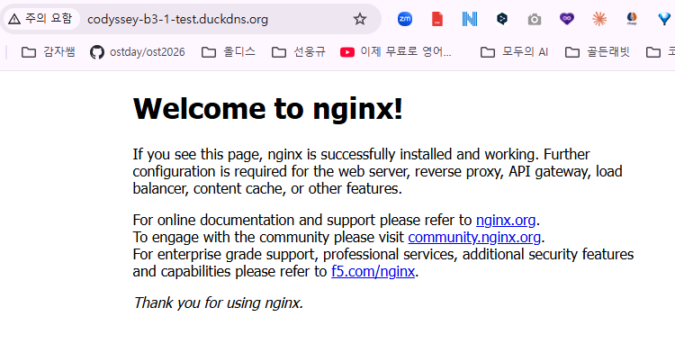
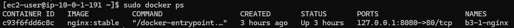

# B3-1 미션 완료 검증서

> **목적:** 미션 원문의 필수 요구사항과 제출 산출물을 평가자가 빠르게 검증할 수 있도록 **판정 기준 → 실제 결과 → 직접 증빙**을 한곳에 연결한다. 프로젝트 구성에 대한 자세한 설명은 [README](../README.md) 및 [아키텍처 문서](architecture.md)를 참조한다.
>
> **검증 기준일:** 2026-10-29 · **리전:** `ap-northeast-2` · **근거:** L0~L7 실습 기록 및 [L7 통합 검증표](../evidence/07-final-verification/L7-final-verification.md)
>
> **상태 정의:** ✅ 확인 = 기록과 증빙으로 확인됨 · ⚠️ 부분 확인 = 일부 근거 부족 · ⬜ 미완료 = 아직 완료 근거 없음 · ➕ 선택 = 보너스 과제

## 0. 평가자용 결론

| 범위 | 판정 | 검증 포인트 |
|---|---|---|
| 네트워크·EC2·웹 서버·접근 제어·외부 접속 | ✅ 확인 | 아래 **1~3절** 증빙 링크 |
| IAM 사용자 및 실습용 최소권한 정책 | ✅ 미션 기준 확인 | IAM 정책 2개 Statement의 작업 범위·서울 리전 제한 및 연결 정책 3개 확인; 전체 유효 권한 감사와는 구분 |
| 필수 산출물 4종 | ✅ 파일 작성 확인 | 아키텍처·외부 접속 증빙·트러블슈팅 보고서·정리 체크리스트 존재; 리소스 삭제는 별도 미완료 |
| HTTPS 및 Docker 보너스 | ✅ 확인 | 아래 **4절** 증빙 링크 |
| 실습 리소스 종료·삭제 | ⬜ 미완료 | 비용 방지를 위한 종료 후 삭제 확인 필요 |

**현재 종합 판정: 미션 최종 완료 확정 전.** 네 가지 제출 파일은 작성되었고 AWS 구축·외부 접속·실습용 IAM 정책 구성은 미션 기준으로 확인되었다. 다만 **실제 리소스 종료·삭제와 그 증빙 기록은 미완료**이며, 제출 전 링크·이미지 및 민감정보를 최종 점검해야 한다.

## 1. 제출 산출물 4종 검증

미션 원문 **§2 최종 결과물** 기준.

| 필수 산출물 | 원문 최소 기준 / 합격 판단 | 제출 경로 / 증빙 | 상태 |
|---|---|---|---|
| ① 아키텍처 다이어그램 | PNG/PDF 1장; VPC, Subnet, IGW, EC2, SG와 외부→서비스 트래픽 흐름 | [다이어그램](architecture.png) · [상세 설명](architecture.md) | ✅ 작성됨 — 도면 구성요소 최종 육안 점검 권장 |
| ② 외부 접속 증빙 | 방식 A 또는 B 명시; URL/IP 기재; 정상 표시/200 스크린샷 1장 이상 | **방식 A:** `http://3.38.97.202/` · [README의 방식 명시](../README.md#1-서비스-접속-및-외부-검증) · [외부 브라우저 캡처](../evidence/07-final-verification/L7-external-http.png) | ✅ 확인 |
| ③ 트러블슈팅 보고서 | `docs/troubleshooting.md` 또는 PDF; 증상→가설→검증→조치→결과→재발 방지 | [작성된 보고서](troubleshooting.md) · [오류 로그](../evidence/06-troubleshooting/L6-nginx-error-log.png) · 장애 전/중/후 증빙 | ✅ 작성 확인 |
| ④ 리소스 정리 체크리스트 | `docs/cleanup-checklist.md` 및 실습 종료 후 정리 완료 근거 | [작성된 체크리스트](cleanup-checklist.md); **실제 리소스 삭제·결과 기록은 미완료** | ⚠️ 문서 작성 완료 / 정리 미완료 |

### ② 외부 접속 증빙 상세

- **선택 방식:** (A) 외부 브라우저에서 `http://<퍼블릭IP>` 접속
- **실제 접속 URL:** `http://3.38.97.202/`
- **관찰 결과:** 웹페이지 정상 표시 및 HTTP 200 (L3/L7 기록)
- **증빙:** [L3 외부 HTTP](../evidence/03-ec2-nginx/L3-external-http.png) · [L7 외부 HTTP](../evidence/07-final-verification/L7-external-http.png)

> 접속 URL은 실습 당시 값이다. 향후 리소스 삭제 후에는 실제 접속이 되지 않아도 당시 검증 스크린샷으로 확인한다.

## 2. 기능 요구사항 검증

미션 원문 **§4 기능 요구 사항**을 빠짐없이 대응한다.

### 2.1 네트워크 구성 (§4-1)

| 원문 요구사항 | 구축/검증 결과 | 증빙 | 판정 |
|---|---|---|---|
| VPC 1개 생성 | VPC `10.0.0.0/16`, available | [VPC](../evidence/07-final-verification/L7-vpc.png) | ✅ |
| Public Subnet 1개 생성 | Subnet `10.0.1.0/24`, 해당 VPC 소속 | [Subnet](../evidence/07-final-verification/L7-subnet.png) | ✅ |
| IGW를 VPC에 연결 | IGW 연결 상태 확인 | [IGW](../evidence/07-final-verification/L7-igw.png) | ✅ |
| Public Subnet에 `0.0.0.0/0 → IGW` | Subnet은 **VPC Main Route Table을 상속**; 해당 테이블에 활성 기본 경로 | [라우팅 테이블](../evidence/07-final-verification/L7-route-table.png) · [서브넷 라우팅](../evidence/07-final-verification/L7-subnet-routing.png) | ✅ |
| 인스턴스 인터넷 아웃바운드 | L3에서 외부 HTTP 요청 성공 기록 | [아웃바운드 HTTP](../evidence/03-ec2-nginx/L3-outbound-http.png) | ✅ |

### 2.2 컴퓨트 및 웹 서버 (§4-2)

| 원문 요구사항 | 구축/검증 결과 | 증빙 | 판정 |
|---|---|---|---|
| Public Subnet에 EC2 1대 | `t3.micro`, Amazon Linux 2023, 퍼블릭 IPv4 부여, running | [EC2](../evidence/07-final-verification/L7-ec2.png) · [네트워크](../evidence/03-ec2-nginx/L3-ec2-network.png) | ✅ |
| SSH 접속 가능 | `ec2-user` SSH 접속 성공 | [SSH 접속](../evidence/07-final-verification/L7-ssh.png) | ✅ |
| Nginx 설치·실행 | 호스트 Nginx `active`, `enabled` | [서비스 상태](../evidence/07-final-verification/L7-nginx-service.png) | ✅ |
| 인스턴스 `curl http://localhost`가 200 | 호스트 Nginx 경유 로컬 HTTP 200 | [로컬 프록시 HTTP](../evidence/07-final-verification/L7-nginx-proxy-http.png) | ✅ |

### 2.3 보안 그룹 (§4-3)

| 원문 요구사항 | 구축/검증 결과 | 증빙 | 판정 |
|---|---|---|---|
| 필요한 포트만 인바운드 허용 | SSH 22, HTTP 80, HTTPS 443 규칙 확인 | [전체 SG](../evidence/07-final-verification/L7-security-group.png) | ✅ |
| HTTP 80을 `0.0.0.0/0`에 공개 | 인바운드 규칙 및 외부 HTTP 접속 확인 | [SG](../evidence/07-final-verification/L7-security-group.png) · [외부 HTTP](../evidence/07-final-verification/L7-external-http.png) | ✅ |
| SSH 22는 개인 IP 또는 지정 대역 | 특정 공인 IPv4 `/32` 제한 | [SSH 소스 제한](../evidence/07-final-verification/L7-security-group-ssh.png) | ✅ |
| 전체 포트(0~65535) 공개 금지 | 수집한 SG 규칙에서 전체 공개 없음 | [SG](../evidence/07-final-verification/L7-security-group.png) | ✅ |

### 2.4 IAM 최소권한 (§4-4)

| 원문 요구사항 | 확인 결과 | 증빙 | 판정 |
|---|---|---|---|
| 실습 IAM 사용자/Role 사용 | `b3-1-operator` 인증·사용 기록 | [CLI 신원](../evidence/01-account-iam/L1-cli-identity.png) · [L1 요약](../evidence/01-account-iam/L1-summary.md) | ✅ |
| 실습 범위(EC2/VPC/SG)에 필요한 권한으로 제한 | 콘솔에서 `B3-1-EC2-VPC-Policy`의 두 Statement를 확인: `ReadEC2Resources`(`ec2:Describe*`)와 `ManageB31Infrastructure`(미션 관련 VPC·Subnet·IGW·Route Table·SG·EC2·키페어·태그·EBS 작업 열거). 둘 모두 `aws:RequestedRegion=ap-northeast-2`; `Resource:*`이므로 개별 리소스 단위 제한은 아님 | [L1 구성 기록](../evidence/01-account-iam/L1-summary.md) · 이번 최종 검토에서 확인한 콘솔 정책 JSON(추후 스크린샷 보관 권장) | ✅ 미션 기준 확인 |
| `AdministratorAccess` 미부여 | IAM 사용자 Permissions 화면에서 연결 정책 3개(`B3-1-EC2-VPC-Policy`, `IAMUserChangePassword`, `SignInLocalDevelopmentAccess`) 확인, `AdministratorAccess`는 목록에 없음 | [L1 요약](../evidence/01-account-iam/L1-summary.md) · 이번 검토에 제시된 콘솔 화면(저장소 증빙 파일로는 아직 확인되지 않음) | ✅ 연결 정책 목록 기준 확인 |

> **판정 범위:** 이번 세션의 IAM 콘솔 화면으로 연결 정책 3개와 `AdministratorAccess` 부재를 확인했고, 사용자가 제공한 `B3-1-EC2-VPC-Policy`의 두 Statement를 대조했다. 정책은 작업별 열거 및 서울 리전 조건을 적용하므로 **B3-1 미션의 최소권한 요구 취지에 부합**한다. 다만 `Resource: "*"`로 개별 리소스는 제한하지 않으며, 로그인·비밀번호 변경용 나머지 AWS 관리형 정책의 세부 권한, 권한 경계·SCP 등을 포함한 **전체 유효 권한 감사는 수행하지 않았다**. `AccessDenied`는 특정 작업의 거부만 입증한다. 이번 대화에서 확인한 화면/JSON은 저장소의 신규 이미지 증빙으로 업로드되었다고 간주하지 않는다.

### 2.5 외부 접속 (§4-5)

- 요구: A(외부 HTTP 브라우저) 또는 B(`/health` 200) 중 하나.
- 선택: **A**, README에 방식 및 IP/URL 기재.
- 판정: ✅ 확인 — [외부 HTTP 스크린샷](../evidence/07-final-verification/L7-external-http.png) 참조.

### 2.6 운영 안정성 / 과금 방지 (§4-6)

- 요구: EC2, EBS, Elastic IP(있는 경우), IGW, VPC 정리 및 종료·삭제 근거; 실제 사용한 기타 유료 리소스도 점검.
- 현재: 실습 중 EC2/EBS/IGW/VPC **존재·실행** 기록만 확인; 종료/삭제 완료 기록은 없음.
- 판정: **⬜ 실제 정리 미완료.** [체크리스트](cleanup-checklist.md)는 작성되었으며, 실제 삭제 후 리소스별 결과와 시각을 기입해야 한다. **Billing Dashboard 확인은 미션 원문의 권장 사항이며 별도의 필수 합격 조건으로 취급하지 않는다.** 기록 없이 삭제 완료로 표시하지 말 것.

## 3. 장애 재현·복구 검증 (트러블슈팅 보고서의 근거)

L6 기록과 작성된 [트러블슈팅 보고서](troubleshooting.md)에서 다음 사실을 확인했다.

| 흐름 | 확인 내용 | 바로 보기 |
|---|---|---|
| 장애 전 정상 | HTTP/HTTPS 200/200 | [정상 화면](../evidence/06-troubleshooting/L6-before-failure.png) |
| 장애 유발·증상 | Nginx `proxy_pass` 목적지 포트 `8080 → 8081`; HTTP/HTTPS 502/502 | [502 오류](../evidence/06-troubleshooting/L6-failure-502.png) |
| 로그로 원인 검증 | `connect() failed (111: Connection refused)`; upstream `127.0.0.1:8081` | [Nginx 오류 로그](../evidence/06-troubleshooting/L6-nginx-error-log.png) |
| 복구·재검증 | 백업 설정 복원, 문법 검사·reload, HTTP/HTTPS 200/200 | [복구 화면](../evidence/06-troubleshooting/L6-after-recovery.png) |
| 재발 방지 | `proxy_pass`와 실제 Docker 포트 매핑 대조, 설정 테스트 및 변경 후 접속 확인 절차 문서화 | [보고서 7절](troubleshooting.md#7-재발-방지) |

## 4. 보너스 과제 검증 (§5)

| 보너스 | 요구조건 / 실제 결과 | 증빙 | 판정 |
|---|---|---|---|
| ① HTTPS | DuckDNS 도메인 연결, Let's Encrypt 인증서, TLS 검증·외부 HTTPS 성공 | [인증서](../evidence/05-domain-https/L5-certificate-details.png) · [TLS 검증](../evidence/07-final-verification/L7-https-tls-1.png) · [외부 HTTPS](../evidence/07-final-verification/L7-external-https.png) | ✅ ➕ |
| ② Docker 배포 | EC2 Docker, `nginx:stable`, 컨테이너 `b3-1-nginx` Up; `127.0.0.1:8080 → 80/tcp`; 로컬 HTTP 200, 외부 HTTP 접속 | [docker ps](../evidence/07-final-verification/L7-docker-ps.png) · [컨테이너 HTTP](../evidence/07-final-verification/L7-docker-http.png) · [외부 HTTP](../evidence/04-docker/L4-external-http.png) | ✅ ➕ |

**Docker 실행 방식:** EC2에서 `nginx:stable` 컨테이너 실행 → 호스트의 `127.0.0.1:8080`에만 바인딩 → 호스트 Nginx가 HTTP/HTTPS 요청을 역방향 프록시. [README의 이미지/실행방식/포트/증빙 명시](../README.md#3-docker-배포-보너스).

## 5. 제약조건 및 학습 목표 확인

미션 원문 **§3 과제 목표 / §7 제약 사항** 기준.

| 항목 | 현재 근거 / 확인 사항 | 판정 |
|---|---|---|
| 서울 리전 사용 | EC2·VPC 구성의 리전 `ap-northeast-2` | ✅ |
| micro급 EC2와 적정 EBS | `t3.micro`, `gp3` 8GiB | ✅ |
| 별도 IAM 사용자 사용 및 MFA | 사용자 인증, MFA 스크린샷·L1 요약 및 이번 콘솔 정책 검토 | ✅ 미션 기준 확인 |
| 보안 그룹 최소 개방 | 22 특정 `/32`, 80·443 외부 공개, 전체 포트 개방 없음 | ✅ |
| 프리티어/비용 관리 | Budget·크레딧 설정 기록 존재; 실제 전체 기간 무과금 여부는 단정하지 않음 | ✅ 관리 기록 확인 / 비용 확인 권장 |
| 트래픽 경로 설명 가능 | VPC, 서브넷, IGW, 메인 라우팅, SG, EC2, 호스트 Nginx, Docker 요청 흐름 문서화 | ✅ 문서화 |
| 장애 진단 설명 가능 | 502 오류·로그·복구 기록 및 보고서 작성 | ✅ |
| 리소스 삭제/비용 방지 | 종료·삭제 이후 근거 없음 | ⬜ |

## 6. 최종 제출 전 점검

- [x] `docs/troubleshooting.md` 작성 및 L6 증빙 연결.
- [x] `docs/cleanup-checklist.md` 작성 (실제 삭제 여부는 별도 기록).
- [x] IAM 연결 정책 3개 확인 및 `B3-1-EC2-VPC-Policy`의 두 Statement 내용 검토. 미션 기준 최소권한 취지에 부합한다고 판정.
- [ ] 이번 세션에서 확인한 IAM 정책/Permissions 콘솔 화면을 **민감정보 확인 후** 증빙 파일로 저장하고 문서 링크 보강 (선택적 증빙 보완).
- [ ] 실습 리소스 종료·삭제 후 `docs/cleanup-checklist.md`의 실제 결과·시각·증빙을 기록하고 본 검증서 판정을 갱신 (**필수**).
- [ ] 제출 전 이미지·Markdown 링크와 민감정보를 최종 확인.
- [ ] 필요시 Billing Dashboard를 확인하여 잔여 과금 위험 점검 (**원문 권장 사항**).

---

### 검증서 사용 방법

1. 평가자는 **1절 산출물 4종**으로 제출 형식·파일 존재를 먼저 확인한다.
2. **2절 기능 요구사항**의 각 증빙 링크를 열어 실제 실행·설정 결과를 대조한다.
3. **3~4절**로 문제 해결과 선택 과제 수행 여부를 확인한다.
4. **리소스 삭제 및 결과 기록까지 완료한 후** 미션 최종 완료로 판정한다. Billing 확인과 IAM 추가 스크린샷은 권장 증빙 보완으로 구분한다.

이 문서는 **검증 증빙을 연결한 평가용 색인**이다. 과거에 수집된 기록을 바탕으로 작성했으며, 링크된 모든 이미지의 내용에 대해 이번 작성 과정에서 새로 육안 검증한 것은 아니다.
