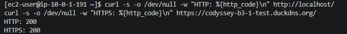
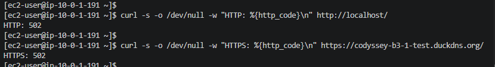
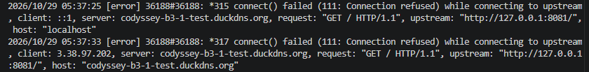
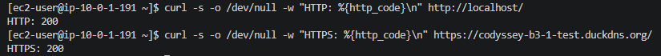

# B3-1 트러블슈팅 보고서 — Nginx Reverse Proxy 502 오류

> **상태:** 장애 재현·원인 확인·복구 검증 완료  
> **사례:** 호스트 Nginx의 프록시 대상 포트를 잘못 지정하여 발생한 `502 Bad Gateway`  
> **관련 미션 요구사항:** 오류를 **증상 → 가설 → 검증 → 조치 → 결과 → 재발방지** 순서로 기록 (`docs/troubleshooting.md`)

## 1. 정상 환경과 장애 전 상태

외부 요청은 EC2의 호스트 Nginx에서 수신하고, 호스트 Nginx가 Docker 컨테이너의 웹서버로 전달한다.

```text
외부 브라우저
  └─ HTTP :80 / HTTPS :443
     └─ EC2 호스트 Nginx (TLS 종료 및 reverse proxy)
        └─ http://127.0.0.1:8080
           └─ Docker 컨테이너 b3-1-nginx (:80, nginx:stable)
```

확인된 포트 매핑은 `127.0.0.1:8080->80/tcp`이다. 호스트 Nginx의 HTTP·HTTPS 서버 블록은 모두 `proxy_pass http://127.0.0.1:8080;`을 사용한다. 장애 재현 이전에는 HTTP와 HTTPS로 정상 응답을 확인했다.



[정상 상태 스크린샷 원본 보기](../evidence/06-troubleshooting/L6-before-failure.png)

## 2. 증상 — HTTP 502 Bad Gateway

학습용 장애 재현을 위해 **호스트 Nginx**의 프록시 대상 포트를 실제 컨테이너 연결 포트인 `8080` 대신 사용하지 않는 `8081`로 변경했다. 이후 외부 HTTP 및 HTTPS 요청에서 **502 Bad Gateway** 응답이 발생했다.

```nginx
# 정상 설정
proxy_pass http://127.0.0.1:8080;

# 장애를 재현하기 위해 변경한 설정
proxy_pass http://127.0.0.1:8081;
```



[502 장애 스크린샷 원본 보기](../evidence/06-troubleshooting/L6-failure-502.png)

## 3. 가설

**가설:** 브라우저와 호스트 Nginx 간 연결은 성립하지만, 호스트 Nginx가 지정한 `127.0.0.1:8081`에는 요청을 받을 프로세스가 없어 업스트림 연결에 실패했을 것이다.

이 가설이 맞다면, Nginx 오류 로그에 업스트림 접속 실패(`Connection refused`)와 잘못된 프록시 대상 포트 `8081`이 함께 나타나야 한다.

## 4. 검증 — 오류 로그와 실제 포트 비교

호스트 Nginx 오류 로그에서 다음 메시지를 확인했다.

```text
connect() failed (111: Connection refused) while connecting to upstream
```

로그가 가리킨 업스트림 주소는 `127.0.0.1:8081`이었다. 반면 Docker 컨테이너는 호스트의 `127.0.0.1:8080`에 연결되어 있었다. 따라서 **프록시 대상 포트 불일치**가 원인임을 확인했다.



[오류 로그 스크린샷 원본 보기](../evidence/06-troubleshooting/L6-nginx-error-log.png)

확인에 사용한 핵심 명령:

```bash
# 호스트 Nginx 설정의 수신 포트와 프록시 대상 확인
sudo nginx -T 2>&1 | grep -E 'server_name|listen |proxy_pass'

# 실제 컨테이너의 포트 매핑 확인
sudo docker ps --format "table {{.Names}}\t{{.Image}}\t{{.Ports}}\t{{.Status}}"

# 호스트 Nginx 오류 로그 확인
sudo tail -n 50 /var/log/nginx/error.log
```

> 위 명령들은 재현·분석 방법을 문서화한 것이다. 제공된 스크린샷과 실습 대화에서 확인된 결과는 로그의 `Connection refused` 및 업스트림 `8081`과 Docker 포트 매핑 `8080`이다.

## 5. 조치 — 프록시 설정 복원

장애 재현 전 백업해 둔 정상 Nginx 설정으로 복원하여 `proxy_pass` 대상을 `127.0.0.1:8080`으로 되돌리고, Nginx 설정을 다시 적용했다.

```nginx
proxy_pass http://127.0.0.1:8080;
```

설정 변경 작업에 적용할 점검 절차:

```bash
sudo nginx -t                  # 설정 문법 확인
sudo systemctl reload nginx   # 정상 설정 반영
```

실습에서는 **백업 설정 복원 및 Nginx reload**를 통해 복구했다. 위 `nginx -t`는 안전한 변경 절차로 함께 기록한 명령이며, 당시 실행 기록이 확인된 것으로 간주하지 않는다.

## 6. 결과 — 서비스 복구 확인

설정 복원 후 외부에서 HTTP와 HTTPS를 다시 요청하여 **둘 다 200 OK**임을 확인했다.



[복구 후 스크린샷 원본 보기](../evidence/06-troubleshooting/L6-after-recovery.png)

| 검증 항목 | 장애 중 | 복구 후 |
|---|---|---|
| 호스트 Nginx 업스트림 주소 | `127.0.0.1:8081` | `127.0.0.1:8080` |
| 외부 HTTP 응답 | 502 | 200 |
| 외부 HTTPS 응답 | 502 | 200 |
| Docker 호스트 포트 매핑 | `127.0.0.1:8080->80/tcp` | 동일 |

## 7. 재발 방지

1. **포트 매핑을 단일 기준으로 관리:** Nginx `proxy_pass` 값과 `docker ps`의 실제 호스트 포트 매핑을 변경 전후에 대조한다.
2. **설정 반영 전 문법 검사:** `sudo nginx -t`가 성공한 경우에만 `sudo systemctl reload nginx`를 실행한다. 단, 문법 검사는 대상 포트의 실제 서비스 가동 여부까지 보장하지 않으므로 별도 접속 검증이 필요하다.
3. **복구 가능한 변경 수행:** Nginx 설정 변경 전 정상 파일을 백업하여 문제가 생기면 즉시 이전 설정으로 되돌릴 수 있도록 한다.
4. **변경 직후 양쪽 프로토콜 확인:** HTTP와 HTTPS 각각의 응답 코드 및 로그를 점검한다.
5. **502 발생 시 점검 순서 통일:** `Nginx 오류 로그 → proxy_pass → Docker 포트 매핑 → 백엔드 실행 상태` 순으로 확인한다.

## 8. 증빙 인덱스

| 증빙 | 보여 주는 사실 | 파일 |
|---|---|---|
| E1 | 장애 전 정상 상태 | [`L6-before-failure.png`](../evidence/06-troubleshooting/L6-before-failure.png) |
| E2 | 502 장애 재현 | [`L6-failure-502.png`](../evidence/06-troubleshooting/L6-failure-502.png) |
| E3 | Nginx 오류 로그의 연결 거부 | [`L6-nginx-error-log.png`](../evidence/06-troubleshooting/L6-nginx-error-log.png) |
| E4 | 설정 복원 후 서비스 정상화 | [`L6-after-recovery.png`](../evidence/06-troubleshooting/L6-after-recovery.png) |

---

**판정:** 네 가지 증빙과 확인된 설정·검증 결과를 근거로, 미션이 요구하는 트러블슈팅 최소 1건의 **증상 → 가설 → 검증 → 조치 → 결과 → 재발방지** 기록을 충족한다. 스크린샷의 세부 내용은 로컬 프로젝트의 해당 이미지와 대조하여 최종 검토한다.
